# Mnemósyne — AI Reflection Journal & Companion Sanctuary

<div align="center">

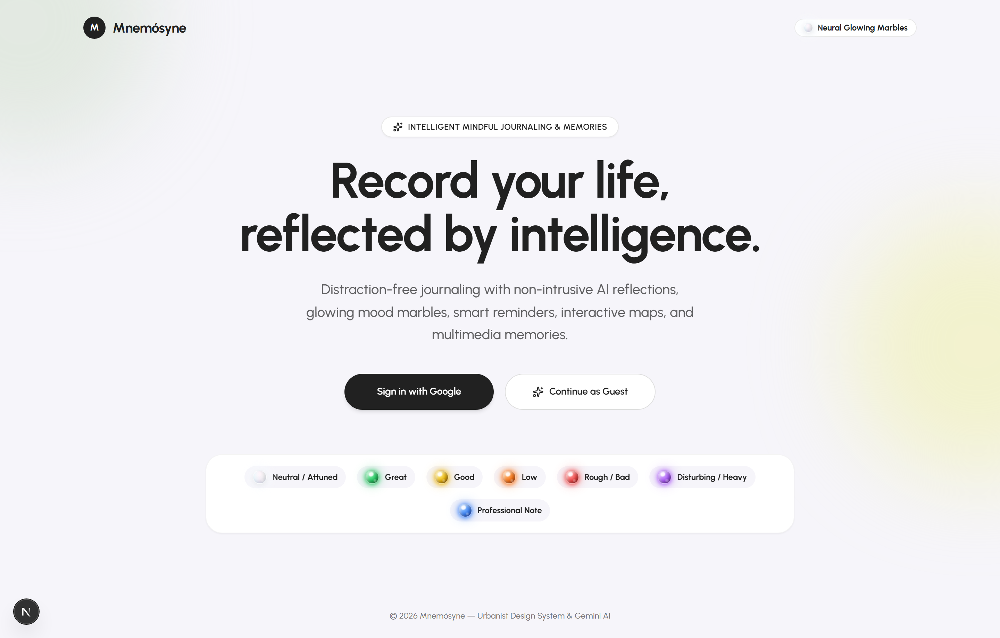

<br />

**Record your life, reflected by intelligence.**  
*A distraction-free, multimodal AI journaling & voice companion sanctuary built with Next.js 15, React 19, Firebase Authentication, Cloud Firestore, Leaflet Maps, and the Google Gemini API.*

[](https://nextjs.org/)
[](https://react.dev/)
[](https://www.typescriptlang.org/)
[](https://ai.google.dev/)
[](https://firebase.google.com/)
[](https://tailwindcss.com/)
[](#testing--automated-audit-suite)

</div>

---

## 📖 Table of Contents

1. [Overview & Philosophy](#-overview--philosophy)
2. [Visual Tour & Screenshots](#-visual-tour--screenshots)
3. [Core Features Breakdown](#-core-features-breakdown)
4. [System Architecture & AI Pipeline](#-system-architecture--ai-pipeline)
5. [Design System & Typography](#-design-system--typography)
6. [Security Posture (OWASP Top 10 for LLMs)](#-security-posture-owasp-top-10-for-llms)
7. [Getting Started (Local Development)](#-getting-started-local-development)
8. [Cloud Configuration & Deployment (Google Cloud Run)](#-cloud-configuration--deployment-google-cloud-run)
9. [Testing & Automated Audit Suite](#-testing--automated-audit-suite)
10. [Project Structure](#-project-structure)

---

## ✨ Overview & Philosophy

**Mnemósyne** (named after the Greek Titaness of memory) reimagines personal journaling as an intimate, tactile, and intelligent sanctuary. Rather than interrupting your flow with intrusive popups, Mnemósyne pairs a **High-GSM Cotton Rag Paper & Royal Blue Fountain Pen Ink** writing canvas with a quiet, empathetic **Gemini AI Mirror** that listens in the background as you write—and a voice-enabled **AI Companion Sanctuary** when you want to talk through your day aloud and crystallize the conversation into a permanent journal memory with a single click.

---

## 🖼️ Visual Tour & Screenshots

### 1. Landing Page & Neural Glowing Marbles Showcase
Passwordless Google Sign-In alongside an instant, zero-friction **Local Guest Mode** with AES-GCM 256-bit local storage encryption and an interactive showcase of all 7 **Neural Glowing Marbles** ([`app/page.tsx`](./app/page.tsx)).


---

### 2. Central Sanctuary Dashboard ([`components/DashboardHome.tsx`](./components/DashboardHome.tsx))
Your daily home base featuring a live **Daily Streak & 7-Day Completion Rhythm** widget, pastel quick-navigation cards (**Journal & Reflections**, **Calendar & Reminders**, **Memories Museum**, **AI Companion Sanctuary**, **Interactive Map**, and **Mindful Analytics**), and a **Quick Jump** grid of recent reflections.

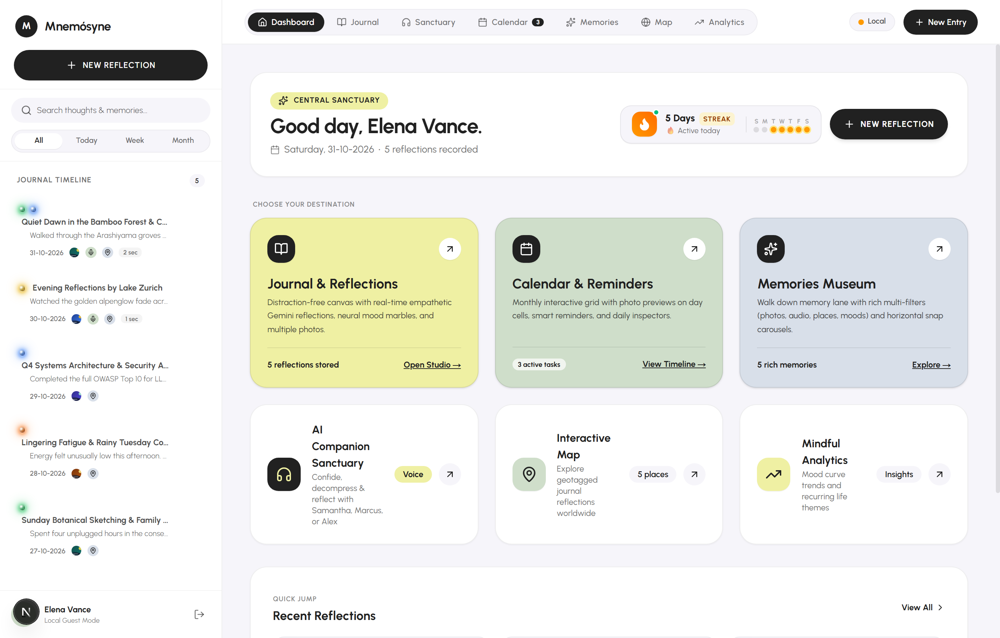

---

### 3. Distraction-Free Journal Studio — Handwritten Blue Ink & Cotton Paper Mode ([`app/page.tsx`](./app/page.tsx))
Write on tactile **High-GSM Cotton Stationery Paper** ([`public/textures/high-gsm-paper.jpg`](./public/textures/high-gsm-paper.jpg)) using cursive **Royal Blue Fountain Ink (`Caveat`)**, complete with circular **`ImageBall` photo attachments** (up to 10 compressed photos per entry), **Multi-Section Chapters** with per-section mood marbles, **Smart Timeline Shift Suggestions** when writing about past dates, and the right-hand **Gemini AI Mirror** drawer.

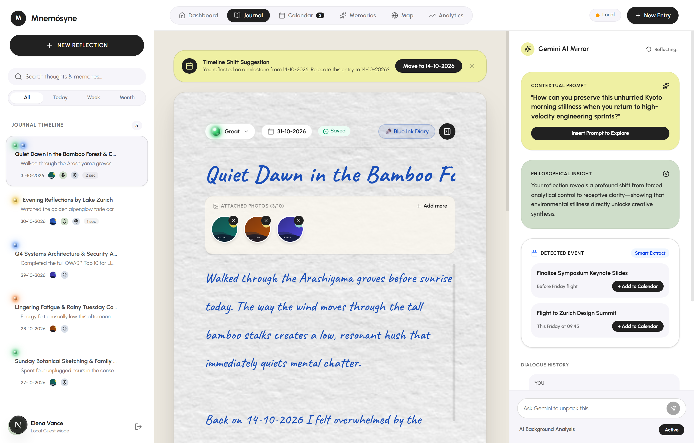

---

### 4. Journal Studio — Modern Editorial Mode & 3D Emotion Marble Picker ([`components/GlowingMarble.tsx`](./components/GlowingMarble.tsx))
Switch seamlessly between **✒️ Blue Ink Diary** and **Aa Modern Editorial** (`Urbanist`) typography with a single click, and assign or override emotional states using the interactive 3D glass **Glowing Marble Picker**.

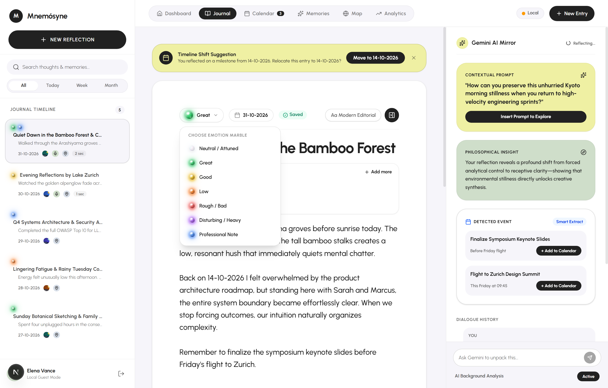

---

### 5. AI Companion Sanctuary & 1-Click Reflection Crystallization ([`components/SanctuaryView.tsx`](./components/SanctuaryView.tsx))
Confide, decompress, and reflect via voice (`Spacebar` push-to-talk + Web Speech TTS) or text with **5 distinct AI personas** (**Samantha**, **Alex**, **Marcus**, **Safe Harbor**, **Socrates**) centered around an interactive 60fps HTML5 Canvas **Living Marble Aura** ([`components/LivingMarbleAura.tsx`](./components/LivingMarbleAura.tsx)). Click **✨ Save as Reflection** to crystallize your dialogue into a first-person journal entry via [`app/api/companion/crystallize/route.ts`](./app/api/companion/crystallize/route.ts).

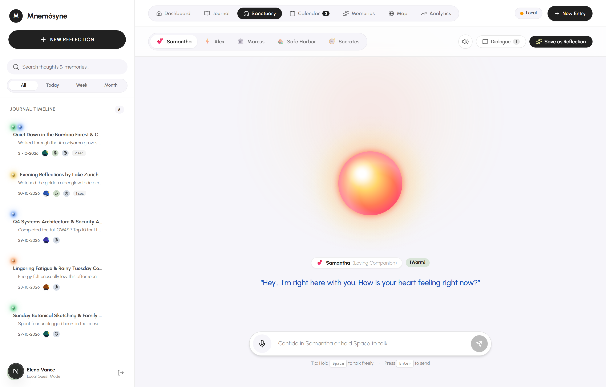

---

### 6. Interactive Monthly Calendar & Smart Reminders ([`components/CalendarView.tsx`](./components/CalendarView.tsx))
Inspect your month at a glance with **day-cell photo thumbnails**, multi-entry badges, and **Glowing Mood Marbles** on every date. Includes a **Daily Inspector** for any selected date and an **AI-Synced Smart Reminders** task manager.

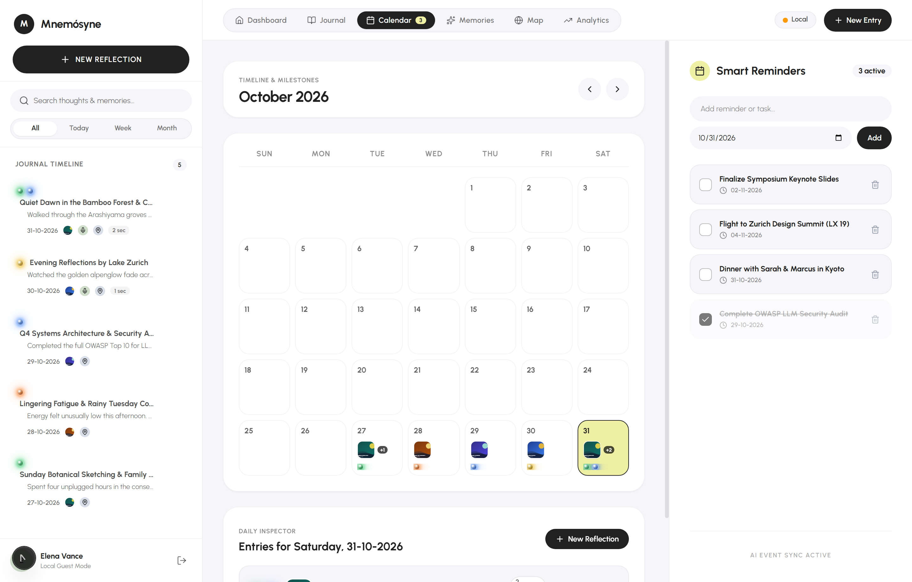

---

### 7. Walk Down Memory Lane — Memories Museum ([`components/MemoriesView.tsx`](./components/MemoriesView.tsx))
An immersive horizontal snap-carousel retrospective that ranks and filters your richest multimedia memories across **Time Ranges** (`All Time`, `Today`, `This Week`, `This Month`, `Past Year`), **Media Types** (`Photos Only`, `Audio Only`, `Geotagged`), and **Mood Marbles**, complete with inline **`AudioNotePlayer`** waveforms ([`components/AudioNotePlayer.tsx`](./components/AudioNotePlayer.tsx)) and **Gemini Insight** pull-quotes.

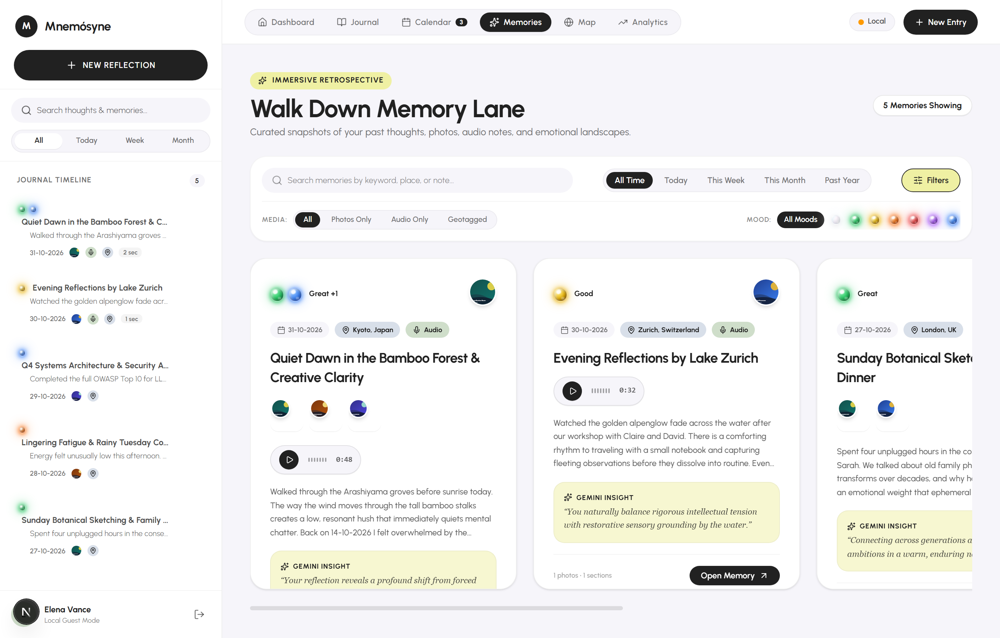

---

### 8. Interactive World Map of Reflections ([`components/MapView.tsx`](./components/MapView.tsx))
Explore geotagged reflections across the globe on an interactive **Leaflet + OpenStreetMap** canvas. Custom pins render your entry's photo thumbnail or **Glowing Mood Marble**, and clicking any pin or drawer item flies smoothly (`flyTo`) to those coordinates and opens the **Selected Reflection Pin** inspector.

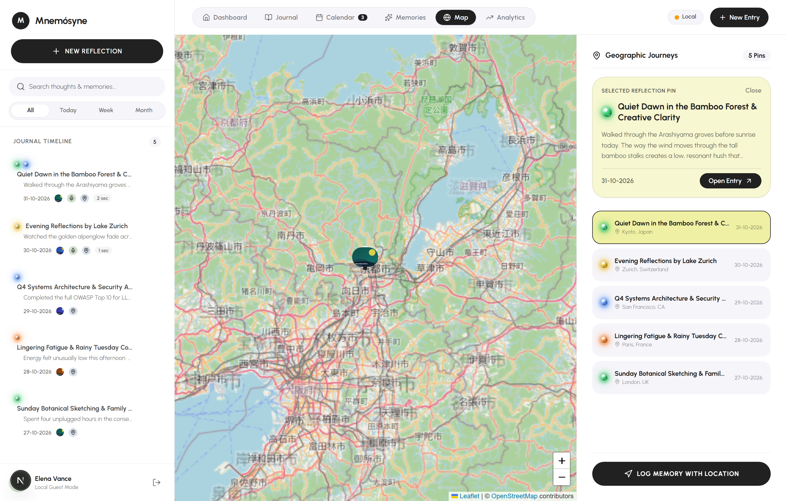

---

### 9. Mindful Intelligence Analytics & Emotional Trajectory ([`components/AnalyticsView.tsx`](./components/AnalyticsView.tsx))
Visualize your inner life with a custom **Dual-Wave Cubic Bézier SVG Spline Chart** comparing **Mood Harmony** against **Reflection Output Volume** across `Today`, `This Week`, `This Month`, or `This Year`, paired with **Reflection Cadence** & **Emotional Resonance** waveform capsules.

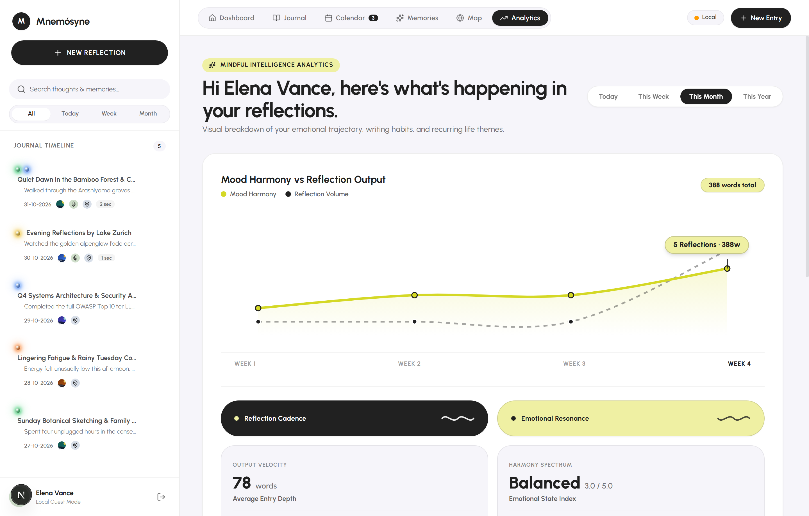

Scroll down in Analytics to explore **Reflection Velocity**, **Mindful Consistency Streaks**, **Recurring People & Entities** automatically extracted by Gemini, a **7-State Mood Marble Breakdown**, and an **AI Writing Style & Linguistic Persona** evaluation:

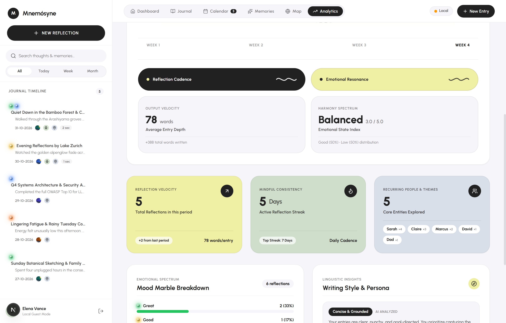

---

## 🚀 Core Features Breakdown

### 🧠 1. Non-Intrusive Real-Time Gemini AI Mirror ([`app/api/analyze/route.ts`](./app/api/analyze/route.ts) & [`app/api/chat/route.ts`](./app/api/chat/route.ts))
* **Background Debounced Analysis**: As you pause typing (2,000ms debounce via [`hooks/useDebounce.ts`](./hooks/useDebounce.ts)), Gemini silently analyzes your title, main content, and individual chapters to return structured JSON insights without interrupting your cursor.
* **Contextual Writing Prompts**: Generates a bespoke, 1–2 sentence open question encouraging you to explore an overlooked angle—with a one-click **"Insert Prompt to Explore"** action.
* **Philosophical Mirror**: Synthesizes a compassionate, philosophical reflection of your entry's core emotional theme.
* **Smart Event Extraction**: Automatically detects upcoming plans, trips, or deadlines mentioned in your prose (e.g., *"Finalize symposium keynote slides before Friday's flight"*) and surfaces a **`+ Add to Calendar`** pill that creates a linked reminder.
* **Retroactive Timeline Relocation**: Detects when you are recounting a memory from a specific past date (e.g., *"Back on 14-10-2026..."*) and offers a one-click banner to relocate the entry to its true historical date on your timeline.
* **Multi-Turn Philosophical Dialogue**: Ask follow-up questions in the right-hand **Dialogue History** stream to unpack thoughts with full context of your entry and chapters.

### 🎧 2. AI Companion Sanctuary & 5-Persona Wheel ([`components/SanctuaryView.tsx`](./components/SanctuaryView.tsx) & [`lib/personas.ts`](./lib/personas.ts))
* **5 Specialized Personas**:
  * **💕 Samantha (`Loving Companion`)**: Affectionate, deeply attentive, and playful; supports English and Romanized Tamil / Tanglish banter.
  * **⚡ Alex (`Ride-or-Die Bestie`)**: Witty, high-energy, fiercely loyal, and unfiltered real talk.
  * **🏛️ Marcus (`Stoic Philosopher & Mentor`)**: Calm, grounded wisdom inspired by Marcus Aurelius to reframe anxiety into quiet strength.
  * **🏡 Safe Harbor (`Nurturing Parent Figure`)**: Unconditional warmth, patient reassurance, and soothing presence.
  * **🧭 Socrates (`Reflective Journaling Coach`)**: Perceptive Socratic questioning to untangle complex emotions.
* **Living Marble Aura ([`components/LivingMarbleAura.tsx`](./components/LivingMarbleAura.tsx))**: 60fps interactive HTML5 Canvas orb that morphs its color palette and harmonic ripples based on the active persona, emotional tone (`[warm]`, `[playful]`, `[thoughtful]`, `[curious]`, `[tender]`), and real-time voice amplitude.
* **1-Click Reflection Crystallization ([`app/api/companion/crystallize/route.ts`](./app/api/companion/crystallize/route.ts))**: Converts your multi-turn companion dialogue into a polished first-person journal entry with an inferred mood marble, tags, and philosophical takeaway.

### 🔮 3. 3D Neural Glowing Mood Marbles ([`components/GlowingMarble.tsx`](./components/GlowingMarble.tsx))
Every entry—and every individual chapter within an entry—is accompanied by a 3D glass sphere with radial gradients, specular glints, and an animated outer halo that pulses while AI is listening:

| Mood State | Label | Visual Signature | Semantic Meaning |
| :--- | :--- | :--- | :--- |
| `neutral` | **Neutral / Attuned** | Opalescent Pearly White (`#e2e8f0`) | Calm, receptive, waiting for your thoughts |
| `great` | **Great** | Radiant Emerald (`#22c55e`) | Joyful, energized, deep gratitude, breakthrough |
| `good` | **Good** | Warm Amber Gold (`#eab308`) | Calm, positive, gentle progress, content |
| `low` | **Low** | Soft Tangerine (`#f97316`) | Fatigued, lingering resistance, wistful |
| `rough` | **Rough / Bad** | Crimson Coral (`#ef4444`) | Stressed, overwhelmed, high friction |
| `disturbing` | **Disturbing / Heavy** | Deep Amethyst (`#a855f7`) | Heavy emotion, unresolved disturbance |
| `professional` | **Professional Note** | Cobalt Sapphire (`#3b82f6`) | Objective work notes, architecture, technical plans |

### ✒️ 4. Multimodal & Multi-Chapter Journaling
* **Dual Typography Modes**: Toggle instantly between **✒️ Blue Ink Diary** (handwritten `Caveat` script in royal blue fountain ink `#1a4eb8` on a textured cotton rag paper sheet) and **Aa Modern Editorial** (clean `Urbanist` sans-serif on a crisp white card).
* **Multi-Section Chapters**: Break complex days into distinct **Journal Chapters & Moments**, each with its own title, body, and independent **Section Emotion Marble** (automatically inferred by Gemini or manually selected).
* **Client-Side Compressed Photo Gallery ([`components/ImageBall.tsx`](./components/ImageBall.tsx))**: Attach up to **10 photos per entry**. Images are automatically compressed via HTML5 Canvas (`maxWidth: 800px`, JPEG quality `0.72`) and displayed as circular glass spheres with a full-screen **Lightbox Modal** zoom.
* **In-Browser Voice Note Recorder & Player ([`hooks/useVoiceRecorder.ts`](./hooks/useVoiceRecorder.ts) & [`components/AudioNotePlayer.tsx`](./components/AudioNotePlayer.tsx))**: Record voice memos directly from your microphone with live duration tracking and play them back inline with animated waveform bars.
* **Geolocation & Manual Place Tagging**: Tag entries with live GPS coordinates (`navigator.geolocation`) or custom city/place names for automatic plotting on the **Interactive World Map**.

---

## 🏗️ System Architecture & AI Pipeline

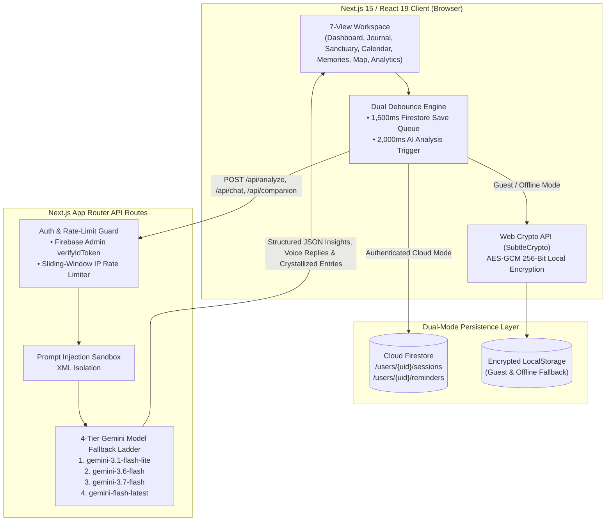

---

## 🎨 Design System & Typography

Mnemósyne implements a bespoke **Urbanist Pastel Sanctuary** aesthetic ([`app/globals.css`](./app/globals.css)) designed for calm cognitive focus and WCAG 2.1 AA contrast compliance:

| Token | Hex | Role in Interface |
| :--- | :--- | :--- |
| **Ghost White** | `#F6F5FA` | Primary ambient application canvas and input surfaces |
| **Eerie Black** | `#212121` | Primary typography, active navigation capsules, and primary CTAs |
| **Vanilla** | `#EFF0A3` | Contextual AI prompts, Journal hub card, and peak analytics highlights |
| **Honeydew** | `#CFDECA` | Philosophical insight mirror, Calendar hub card, and streak consistency cards |
| **Alice Blue** | `#D8DFE9` | Geotagged location badges, Memories Museum hub card, and entity cards |
| **Royal Blue Ink** | `#1a4eb8` | Fountain pen ink typography on `#FAF6EE` / `#FBFBFA` High-GSM cotton paper |

---

## 🛡️ Security Posture (OWASP Top 10 for LLMs)

Mnemósyne is hardened against modern web and LLM-specific threat vectors (detailed in [`Audit_Report.md`](./Audit_Report.md)):

1. **Environment-Aware Token Verification**: Production requests to `/api/analyze`, `/api/chat`, `/api/companion`, and `/api/companion/crystallize` require a cryptographic Firebase ID token verified via `firebase-admin` (`adminAuth.verifyIdToken`). Arbitrary `guest-*` bearer tokens are strictly rejected.
2. **Prompt Injection Sandboxing**: All user-supplied titles, journal prose, section contents, and companion dialogues are stripped of delimiter tags and isolated inside explicit `<untrusted_journal_entry>`, `<untrusted_section>`, `<user_dialogue_prompt>`, and `<conversation_transcript>` XML boundary blocks with strict system-level override immunity.
3. **Sliding-Window API Rate Limiting ([`lib/rate-limit.ts`](./lib/rate-limit.ts))**: Protects Gemini API quotas against burst abuse with standard `429 Too Many Requests` and `Retry-After` headers.
4. **AES-GCM 256-Bit Local Storage Encryption ([`lib/storage-crypto.ts`](./lib/storage-crypto.ts))**: In Guest Mode or offline fallback, personal reflections stored in `localStorage` are encrypted at rest using the browser's native Web Crypto API (`SubtleCrypto` AES-GCM with a SHA-256 derived key and random 96-bit IV).
5. **Throttled Firestore Write Queue**: Editor keystrokes update local React state immediately at 60fps while queuing remote Cloud Firestore `updateDoc` calls behind a **1,500ms trailing debounce** (with automatic `beforeunload` flushing), preventing `429 RESOURCE_EXHAUSTED` write-rate limits.
6. **Resilient Multi-Model Fallback Ladder**: All AI endpoints automatically cascade through `gemini-3.1-flash-lite` -> `gemini-3.6-flash` -> `gemini-3.7-flash` -> `gemini-flash-latest` to guarantee high availability.

---

## 💻 Getting Started (Local Development)

### Prerequisites
* **Node.js** 20+ (Node 22/24 recommended for native test runner support)
* A **Google Gemini API Key** ([Get one from Google AI Studio](https://aistudio.google.com/))
* *(Optional)* A **Firebase Project** with Authentication (Google Sign-In) and Cloud Firestore enabled. *(Note: You can explore the entire app immediately in **Guest Mode** without configuring Firebase!)*

### Installation

1. **Clone the repository and install dependencies:**
   ```bash
   git clone https://github.com/vasanthaganesh/AI-Reflection-Journal.git
   cd AI-Reflection-Journal
   npm install
   ```

2. **Configure environment variables:**
   Copy [`.env.example`](./.env.example) to `.env.local` and add your `GEMINI_API_KEY`:
   ```bash
   cp .env.example .env.local
   ```
   ```env
   GEMINI_API_KEY="YOUR_GEMINI_API_KEY"
   ```

3. **Start the development server:**
   ```bash
   npm run dev
   ```
   Open [http://localhost:3000](http://localhost:3000) in your browser. Click **Continue as Guest** to start journaling immediately, or sign in with Google.

---

## ☁️ Cloud Configuration & Deployment (Google Cloud Run)

### 1. Firestore Security Configuration

Ensure your Firestore database is deployed in **Native mode**. Update your [`firestore.rules`](./firestore.rules) in the Firebase Console to guarantee strict owner-bound data isolation for both `sessions` and `reminders`:

```javascript
rules_version = '2';
service cloud.firestore {
  match /databases/{database}/documents {
    match /users/{userId}/sessions/{sessionId} {
      allow read, write: if request.auth != null && request.auth.uid == userId;
    }
    match /users/{userId}/reminders/{reminderId} {
      allow read, write: if request.auth != null && request.auth.uid == userId;
    }
  }
}
```

### 2. Secret Management Setup

Create a Google Cloud Secret Manager secret for your `GEMINI_API_KEY` and grant access to the Cloud Run service account:

```bash
# Create and populate the secret
gcloud secrets create GEMINI_API_KEY --replication-policy="automatic"
echo -n "YOUR_API_KEY" | gcloud secrets versions add GEMINI_API_KEY --data-file=-

# Grant the default Cloud Run service account access to read the secret
# Replace YOUR_PROJECT_NUMBER with your actual Google Cloud project number.
gcloud secrets add-iam-policy-binding GEMINI_API_KEY \
  --member="serviceAccount:YOUR_PROJECT_NUMBER-compute@developer.gserviceaccount.com" \
  --role="roles/secretmanager.secretAccessor"
```

### 3. Cloud Run Deployment

Deploy the containerized Next.js application ([`Dockerfile`](./Dockerfile) & [`cloudbuild.yaml`](./cloudbuild.yaml)) to Google Cloud Run using the `gcloud` CLI:

```bash
gcloud run deploy ai-reflection-journal \
  --source . \
  --region us-central1 \
  --allow-unauthenticated \
  --set-secrets="GEMINI_API_KEY=GEMINI_API_KEY:latest"
```

### 4. Required Campaign Labeling

Apply the resource label to register the service for challenge verification:

```bash
gcloud run services update ai-reflection-journal \
  --update-labels=dev-tutorial=cloud-run-ai-challenge \
  --region=us-central1
```

---

## 🧪 Testing & Automated Audit Suite

Mnemósyne includes an automated QA, Companion, UX/Accessibility, and Security audit suite built on the native Node.js test runner:

* **[`tests/functional-qa.test.mjs`](./tests/functional-qa.test.mjs)**: Validates entry schemas, trailing 1,500ms Firestore write debouncing, reload context retention, cascade deletion of linked reminders, mood enum sanitization, and live API stress-tests.
* **[`tests/companion.test.mjs`](./tests/companion.test.mjs)**: Verifies the 5 companion personas, emotion tag extraction, prompt sandboxing, and conversation-to-reflection crystallization.
* **[`tests/ux-ui-audit.test.mjs`](./tests/ux-ui-audit.test.mjs)**: Computes mathematical WCAG 2.1 relative luminance and contrast ratios across UI states, verifies `44x44px` minimum touch targets, checks responsive drawer overlays, and audits keyboard ARIA navigation.
* **[`tests/security-audit.test.mjs`](./tests/security-audit.test.mjs)**: Verifies forged `Bearer guest-*` token rejection, sliding-window rate limiting (`429`), AES-GCM 256-bit local storage encryption, XML prompt-injection sandboxing, and package-based Leaflet loading.

Run the complete test suite at any time:

```bash
# Run the unified multi-agent audit runner
npm run test:audit

# Or run individual test suites directly
node --test tests/functional-qa.test.mjs
node --test tests/companion.test.mjs
node --test tests/ux-ui-audit.test.mjs
node --test tests/security-audit.test.mjs
```

---

## 📂 Project Structure

```text
ai-reflection-journal/
├── app/
│   ├── api/
│   │   ├── analyze/route.ts               # Real-time Gemini JSON reflection, mood, & event extraction API
│   │   ├── chat/route.ts                  # Multi-turn philosophical dialogue API with XML sandboxing
│   │   └── companion/
│   │       ├── route.ts                   # Persona-driven AI Companion voice & chat API
│   │       └── crystallize/route.ts       # 1-click dialogue-to-journal crystallization API
│   ├── globals.css                        # Tailwind v4 theme, High-GSM paper texture, & blue ink typography
│   ├── layout.tsx                         # Root layout loading Urbanist & Caveat Google Fonts
│   └── page.tsx                           # LandingPage, MainDashboard, & JournalEditorView orchestrator
├── components/
│   ├── AnalyticsView.tsx                  # Dual-Wave SVG spline chart, mood breakdown, & writing persona
│   ├── AudioNotePlayer.tsx                # Inline voice note player with animated waveform bars
│   ├── CalendarView.tsx                   # Interactive monthly grid with photo thumbnails & Smart Reminders
│   ├── DashboardHome.tsx                  # Central Sanctuary home with streak rhythm & destination cards
│   ├── GlowingMarble.tsx                  # 3D glass emotion sphere with ambient halo & listening pulse
│   ├── ImageBall.tsx                      # Circular photo sphere with full-screen Lightbox modal
│   ├── LivingMarbleAura.tsx               # 60fps HTML5 Canvas fluid/particle orb for Companion Sanctuary
│   ├── MapView.tsx                        # Interactive Leaflet + OpenStreetMap reflection pin explorer
│   ├── MemoriesView.tsx                   # Multi-filter retrospective museum & horizontal snap carousel
│   └── SanctuaryView.tsx                  # AI Companion Sanctuary with 5 personas, TTS, & crystallization
├── hooks/
│   ├── useDebounce.ts                     # Generic reactive value debouncer for background AI analysis
│   └── useVoiceRecorder.ts                # Browser MediaRecorder hook returning base64 audio & duration
├── lib/
│   ├── firebase-admin.ts                  # Server-side Firebase Admin SDK initialization
│   ├── firebase.ts                        # Client Firebase Auth, Firestore, & Local Guest Mode helpers
│   ├── personas.ts                        # 5 Companion persona definitions, aura colors, & system prompts
│   ├── rate-limit.ts                      # Sliding-window IP rate limiter for API routes
│   ├── storage-crypto.ts                  # Native Web Crypto API (AES-GCM 256-bit) local encryption
│   ├── types.ts                           # Core TypeScript interfaces & 7-state MOOD_CONFIGS definitions
│   └── utils.ts                           # DD-MM-YYYY date formatting & parsing utilities
├── public/
│   ├── screenshots/                       # High-resolution application screenshots (01 through 10)
│   └── textures/high-gsm-paper.jpg        # Cotton rag stationery background texture
├── tests/                                 # Automated Functional, Companion, UX/UI, & Security audit tests
├── Dockerfile                             # Multi-stage Node 20 Alpine production container build
├── firestore.rules                        # Owner-isolated Cloud Firestore security rules
└── README.md                              # Project documentation & visual guide
```
